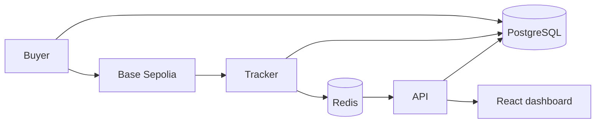

# testnet-payments

A payment-tracking demo follows test USDC purchases on Base Sepolia from broadcast through confirmation, settlement and shop notification. Separate buyer, tracker and API services share a PostgreSQL ledger and Redis, with a React dashboard showing payment progress.



Only transfers from `BUYER_ADDRESS` are matched to orders. Any other USDC transfer to the shop is a donation: it is stored with its sender and settles with a ledger entry, but has no order, no shop notice and no `unmatched` incident (a reorg or duplicate still records its own incident). The API shows a donation under a stable two-word name derived from the sender and never returns the address. Donations below `DONATION_MIN` are stored but not listed, streamed or counted.

Chain payments follow `sent → received → confirming → settled → notified` and gain a final flag when the chain finalizes their block. The ledger's unique payment key enforces one credit per payment.

## Purchases

Two kinds of purchase share one send path and have separate limits.

- **Scheduled purchases** make the shop look busy through the day. They share a daily budget per UTC day, by count and total amount (`DAILY_COUNT_CAP`, default 100; `DAILY_AMOUNT_CAP`, default 200 USDC).
- **Visitor test buys** (`POST /test-purchases`) are sent at once, at the highest queue priority and outside the daily budget, so a visitor never waits behind the schedule. The response carries the order id and its queue position; `GET /test-purchases/:id` returns the position of a purchase that is still waiting, and the checkout shows "Queued · N ahead" until it is sent.

Visitor limits, with their defaults:

| Limit                         | Default                    | Response                         |
| ----------------------------- | -------------------------- | -------------------------------- |
| Per visitor (IP, hashed)      | 10 a minute, 100 a UTC day | `429` with `Retry-After`         |
| Waiting visitor purchases     | 30                         | `429` "busy", with `Retry-After` |
| Visitor purchases per UTC day | 2,000                      | `409` until 00:00 UTC            |
| Buyer gas below `GAS_FLOOR`   | n/a                        | `503` until topped up            |

Visitor purchases pause while the buyer's gas balance is below `GAS_FLOOR` and resume when it is topped up.

## Recycling and retention

USDC circulates only between the buyer and shop wallets. A nightly sweep at 03:00 UTC returns the shop's USDC to the buyer. A refill does the same on demand: when the buyer's USDC falls below `REFILL_BELOW` and the shop holds USDC and enough gas, the shop sends its whole USDC balance to the buyer, at most once per `REFILL_COOLDOWN_SECONDS`. The running cost is gas.

A nightly job deletes orders, payments, ledger entries, notices, events and incidents older than `RETENTION_DAYS` (default 30), and resolved scan gaps of the same age. Open orders and payments that are unsettled or not final are kept until they close. A transfer closed because it can never land is deleted by its send time.

## RPC budget

The services run on free RPC tiers, so request volume stays inside their rate limits.

- Each service has its own request rate (`RPC_REQUESTS_PER_SECOND_TRACKER`, `RPC_REQUESTS_PER_SECOND_BUYER` and `RPC_REQUESTS_PER_SECOND_API`; defaults 2, 2 and 1). Together they stay at or below the provider's rate, and a burst of purchases cannot stall confirmations. A limiter delays a call until its slot instead of refusing it.
- The buyer makes about one RPC call per send (a send held for funds also reads the balance, a second call cached for 3 seconds): it signs locally with a nonce allocated in the database, a fixed gas limit and a fee cached for a few seconds. It checks for a receipt only when retrying.
- At most `MAX_IN_FLIGHT` (default 10) transfers wait unconfirmed at once. A send beyond that returns to its queue for a moment and does not count as a failed attempt.
- Before an order is sent, the buyer checks that its cached USDC balance, less the amounts in flight, covers the order. If not, the send is delayed 2 seconds and does not count as a failed attempt; the order can still expire and close.
- Every minute the buyer checks transfers the tracker has not seen two minutes after sending. One that reverted, or whose nonce another transaction used, can never land. A revert, read from its receipt, is closed with an incident at once and leaves the in-flight count; one with no receipt and a used nonce is closed only after two consecutive checks agree, and an order that leaves the unseen list forgets the suspicion. Any other is broadcast again. This check and the refill check run on their own `buyer-upkeep` queue, so held sends never delay them.
- The tracker reads new payments with one `eth_getLogs` call per pass and takes confirmations from the latest block number.

## Rescans and duplicates

Each tracker pass re-reads the last `RESCAN_BLOCKS` blocks. A log re-read inside that overlap, in the same block, is skipped silently. A log seen again anywhere else, such as a gap retry or a replay after a restart, is skipped and recorded as a duplicate.

## API routes

| Route                     | Purpose                                                                                                             |
| ------------------------- | ------------------------------------------------------------------------------------------------------------------- |
| `GET /payments?limit=`    | Recent payments with order, stage, confirmations, block and explorer URL                                            |
| `GET /stats`              | Today only: settled count, average time to settle, duplicates skipped, failures recovered                           |
| `GET /stats/daily`        | Per UTC day for the retained period: settled count, average time to settle, scheduled and visitor purchases         |
| `GET /incidents?limit=`   | Recent incidents                                                                                                    |
| `GET /health`             | Head, cursor, lag, open gaps, queue depth, cooldown state, balances, low-balance flags and the `monitoring` signals |
| `GET /events`             | Server-sent events relayed from Redis pub/sub                                                                       |
| `POST /test-purchases`    | Visitor test buy                                                                                                    |
| `GET /test-purchases/:id` | Queue position of a waiting visitor purchase                                                                        |
| `POST /shop/notices`      | Receives the signed notice, verifies its signature and timestamp, then marks the payment notified                   |

Each 4xx answers with a fixed body. Errors that reach the error filter get a fixed code for their status, such as `bad_request` or `rate_limited`, and routes send their own fixed codes, such as `busy` or `daily_limit`; bodies never echo messages.

Set `TRUST_PROXY=true` when the API runs behind exactly one reverse proxy or tunnel. Client addresses then come from the proxy's forwarding header, so per-visitor limits apply to visitors rather than to the proxy. Leave it `false` when clients connect directly.

## Monitoring

`GET /health` includes a `monitoring` object that an external monitor can alert on:

| Signal                                                          | Alert when      |
| --------------------------------------------------------------- | --------------- |
| Time since the tracker cursor last advanced                     | over 1 hour     |
| Age of the oldest payment in `sent`, `received` or `confirming` | over 1 hour     |
| Age of the oldest settled payment not yet notified              | over 1 hour     |
| Time since the last scheduled purchase                          | over 24 hours   |
| Time visitor test buys have been paused by the gas floor        | over 24 hours   |
| `/health` itself unreachable                                    | over 30 minutes |

Each condition must hold for its whole window, so failures that the services recover from on their own do not alert.

Head and balances come from one chain reading that the API refreshes at most every 10 seconds, so `/health` never waits on the RPC provider. Before the first reading, or when the latest read failed, they are `null` and `chainError` names the error category. Queue depth and cooldowns are `null` while Redis is down. `/health` answers `503` only when the database is down.

## Web views

The dashboard at `/` has a checkout card, a small widget and a full panel. Each receipt shows at most one note. The full panel charts settled payments per day and per week from `/stats/daily`. The widget can also be shown alone at `/?view=widget`.

## Run locally

Use Node 24, pnpm 10 and Docker Compose.

```sh
corepack enable
pnpm install
cp .env.example .env
chmod 600 .env
pnpm db:migrate --name init
pnpm build
```

Run `pnpm wallets:new` to generate buyer and shop keys with private file permissions. It preserves existing keys and prints public addresses. Fill the remaining blank configuration values in `.env` before starting the services. Use test-network keys and set `USDC_ADDRESS` to the contract address verified against Circle's documentation for the configured chain.

Run each service in a separate terminal:

```sh
pnpm start:buyer
pnpm start:tracker
pnpm start:api
pnpm dev:web
```

Buyer and tracker run as Nest application contexts. The API serves HTTP on port 3000 by default. Vite serves the web app at `http://localhost:5173`. Each backend validates its configuration at startup. `pnpm dev:buyer`, `pnpm dev:tracker` and `pnpm dev:api` rebuild on changes.

PostgreSQL binds to `127.0.0.1:55432` and Redis to `127.0.0.1:56379`. `pnpm db:migrate` waits for healthy services before running Prisma migrations. Compose volumes persist their data. `docker compose down` stops the services.

## Configuration

`.env.example` lists the environment variables; `libs/config/src/index.ts` defines validation and defaults. Money settings use integer micro-units; native balance thresholds use wei. Quiet-window hours and budget days use UTC.

| App          | Required configuration                                              |
| ------------ | ------------------------------------------------------------------- |
| All backends | `DATABASE_URL`, `REDIS_URL`, `CHAIN_ID`, `RPC_URL`, `USDC_ADDRESS`  |
| Buyer        | `BUYER_PRIVATE_KEY`, `SHOP_PRIVATE_KEY`                             |
| Tracker      | `BUYER_ADDRESS`, `SHOP_ADDRESS`, `NOTICE_SECRET`, `SHOP_NOTICE_URL` |
| API          | `BUYER_ADDRESS`, `SHOP_ADDRESS`, `NOTICE_SECRET`, `WEB_ORIGIN`      |

Optional settings and their defaults:

| Setting                                      | Default                        | Meaning                                                                                         |
| -------------------------------------------- | ------------------------------ | ----------------------------------------------------------------------------------------------- |
| `API_PORT`                                   | 3000                           | API HTTP port                                                                                   |
| `BLOCK_EXPLORER_URL`                         | `https://sepolia.basescan.org` | Base URL for explorer links                                                                     |
| `CONFIRMATIONS`                              | 10                             | Blocks on top of a payment's block before it settles                                            |
| `START_BLOCK`                                | `RESCAN_BLOCKS` below the head | First block the tracker scans when it has no cursor                                             |
| `RESCAN_BLOCKS`                              | 5                              | Blocks re-read on each tracker pass                                                             |
| `MAX_RANGE`, `MIN_RANGE`                     | 500, 10                        | Largest and smallest block range per log query; a rejected range is halved down to the minimum  |
| `ACTIVE_POLL_MS`, `IDLE_POLL_MS`             | 2000, 30000                    | Tracker poll interval while payments are open, and otherwise                                    |
| `RPC_COOLDOWN_MS`                            | 30000                          | Pause for a service after a rate-limit response                                                 |
| `RPC_MAX_ATTEMPTS`, `GAP_MAX_ATTEMPTS`       | 3, 5                           | Attempts per RPC call, and attempts per stored scan gap                                         |
| `ORDER_TTL_MINUTES`                          | 30                             | Minutes before an unpaid order expires                                                          |
| `QUIET_START_HOUR_UTC`, `QUIET_END_HOUR_UTC` | 0, 7                           | UTC hours in which scheduled purchases are less likely                                          |
| `LOW_NATIVE_BALANCE`, `LOW_USDC_BALANCE`     | 1000000000000000, 10000000     | Balances (wei, micro-units) below which the dashboard shows a warning                           |
| `RPC_REQUESTS_PER_SECOND_TRACKER`            | 2                              | Tracker's RPC request rate                                                                      |
| `RPC_REQUESTS_PER_SECOND_BUYER`              | 2                              | Buyer's RPC request rate                                                                        |
| `RPC_REQUESTS_PER_SECOND_API`                | 1                              | API's RPC request rate; the three together stay within the provider's rate                      |
| `DAILY_COUNT_CAP`, `DAILY_AMOUNT_CAP`        | 100, 200000000                 | Scheduled purchases per UTC day and their total in micro-units (200 USDC)                       |
| `VISITOR_PER_MINUTE`, `VISITOR_PER_DAY`      | 10, 100                        | Visitor purchase limits per client                                                              |
| `VISITOR_QUEUE_LIMIT`                        | 30                             | Visitor purchases waiting at once                                                               |
| `VISITOR_DAILY_LIMIT`                        | 2000                           | Visitor purchases per UTC day across all clients                                                |
| `DONATION_MIN`                               | 10000                          | Smallest donation in micro-units (0.01 USDC) the API lists, streams and counts                  |
| `GAS_FLOOR`                                  | 200000000000000                | Native balance floor in wei (0.0002 ETH)                                                        |
| `REFILL_BELOW`, `REFILL_COOLDOWN_SECONDS`    | 5000000, 20                    | Buyer USDC balance in micro-units (5 USDC) that triggers a refill, and the wait between refills |
| `MAX_IN_FLIGHT`                              | 10                             | Buyer purchases in flight at once                                                               |
| `RETENTION_DAYS`                             | 30                             | Days that records are kept                                                                      |
| `TRUST_PROXY`                                | `false`                        | Set `true` to read the client address from proxy headers                                        |

`NOTICE_SECRET` must contain at least 32 characters. Missing or invalid variables are reported together by name without printing their values. `TEST_DATABASE_URL` points database tests at the local PostgreSQL instance; tests needing isolation create and reset their own schema. `TEST_REDIS_URL` points Redis and queue tests at a Redis database separate from `REDIS_URL`, because they clear their queues. `VITE_API_URL` supplies the web app's API origin and `VITE_REPO_URL` the repository link in the "How this works" text.

## Workspace and checks

`apps/` holds the NestJS services. `libs/db` owns the Prisma schema and client module; `libs/config` owns environment validation. Shared chain, domain and event code belongs in `libs/chain`, `libs/core` and `libs/events`. `web/` uses React, Vite and Vitest; `scripts/` holds command-line utilities.

```sh
pnpm lint
pnpm test
pnpm build
```

Jest tests prove that each app's startup validation reports every missing required variable without exposing environment values. Vitest runs the web test suite. The initial migration creates the payment tables, foreign keys and unique constraints; Prisma generates the client during the build.

## Buyer jobs

The buyer queues a pacing job every UTC minute, checks the saved daily target, and reserves each order’s exact amount before enqueueing its send. Scheduled sends wait a random offset below 60 seconds; `visitor-purchase` jobs carry `{ orderId }`, run immediately at priority 1, and use the same reservation path. An order id identifies one reservation across job retries. Pending orders are recovered at startup and each minute if enqueueing was interrupted.

Open unpaid orders expire each minute. A nightly job at 03:00 UTC returns the shop’s USDC to the buyer. Sweeps have their own durable row per UTC day and use the purchase send path without consuming the purchase budget.

A Redis lock serializes each sender. A database nonce row preserves allocations across restarts and fences an expired Redis lease. Signed transfers and hashes are committed before broadcast. Retries look for a receipt and otherwise rebroadcast the stored bytes. A failure before signing can release its reservation; an uncertain broadcast keeps it. Jobs use five attempts with exponential backoff and jitter. Exhausted sends enter `review`, retain their reservation, and write an incident for manual review. Pending sends do not automatically retry after that limit.

A broadcast purchase creates a `sent` payment keyed by `sent:<order id>`. Its log index is empty until chain observation; the tracker correlates the transaction hash with this payment when recording its transfer log.

Buyer tests use a scripted chain client, isolated PostgreSQL schemas and local Redis queues. They cover the hold on a short balance, the two-run drop check, both crash windows around broadcast, durable nonce allocation, budget races and restart recovery, priority and pacing, expiry, sweep retries and failure incidents. Chain adapter tests use a local scripted transport; no automated test contacts a live chain.
