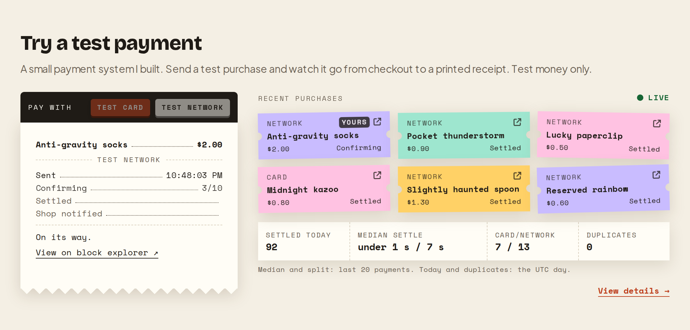
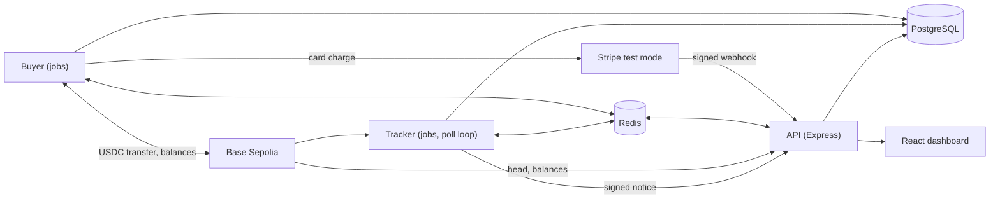

# payment-pipeline-demo

[](https://github.com/batihandev/payment-pipeline-demo/actions/workflows/ci.yml)

**[Send a live test payment](https://batihanozdemir.com/#test-payment)** and watch it settle.



How it works, the payment stages and live figures: [batihanozdemir.com/payments-demo](https://batihanozdemir.com/payments-demo)

A payment-tracking demo follows test purchases through two payment rails into one ledger. On the chain rail, test USDC moves on Base Sepolia from broadcast through confirmation, settlement and shop notification. On the card rail, a saved Stripe test card is charged and the payment settles from a signed Stripe webhook. Separate buyer, tracker and API services share a PostgreSQL ledger and Redis, with a React dashboard showing payment progress.

## What it handles

- **One credit per payment.** A unique payment key and one ledger entry per payment, written under a row lock, so a repeat changes nothing. See [Chain payments](#chain-payments).
- **Matching transfers to orders.** Each chain order expects a unique amount; transfers from any sender other than the buyer wallet are kept apart as donations. See [Orders and matching](#orders-and-matching).
- **Reorgs and duplicates.** Recent blocks are re-read every pass. If a block leaves the chain, an unsettled payment is rolled back and rescanned, and a settled one is held for review. A log seen twice is skipped, and recorded as a duplicate unless it was an expected re-read. See [Rescans and duplicates](#rescans-and-duplicates).
- **Card settlement from signed webhooks.** Card payments settle from verified Stripe webhooks, and reconciliation applies the same result for webhooks that never arrive. See [Card payments](#card-payments) and [Reconciliation](#reconciliation).
- **No double charges.** Each Stripe charge carries the idempotency key `order-<order id>`, so a retried send returns the same PaymentIntent. See [Card setup](#card-setup).
- **Safe sending.** One sender at a time per wallet, nonces kept in the database, and signed transfers stored before broadcast. See [Buyer jobs](#buyer-jobs).
- **Free-tier budgets.** Per-service RPC and Stripe request rates with cooldowns. See [RPC and Stripe budgets](#rpc-and-stripe-budgets).
- **Deploys without API downtime.** Expand-only migrations, a health-checked new API before it takes traffic, and the tracker and buyer each stopped before their replacement starts. See [Deploy and roll back](#deploy-and-roll-back).
- **Alertable health.** `/health` carries the signals an external monitor alerts on. See [Monitoring](#monitoring).



Stack: NestJS apps over shared libraries, Prisma on PostgreSQL, BullMQ on Redis, viem on Base Sepolia, Stripe in test mode, and a React and Vite dashboard.

## Contents

- [Test mode and running cost](#test-mode-and-running-cost)
- [How it works](#how-it-works): orders and matching, chain payments, card payments, reconciliation, purchases, buyer jobs, recycling and retention, RPC and Stripe budgets, rescans and duplicates
- [Interfaces](#interfaces): API routes, monitoring, web views
- [Running it](#running-it): run locally, card setup, deploy, configuration, workspace and checks

## Test mode and running cost

Both rails run on test networks only, and Stripe runs in test mode with test keys only. The demo pays with a test card saved on its own Stripe customer, so visitors never enter card details (see [Card setup](#card-setup)). No card data is stored beyond Stripe IDs, the card brand and its last four digits. Apart from the server it runs on, every service it uses is free: Base Sepolia test tokens from a faucet, Stripe test mode and public RPC endpoints. Request rates, daily purchase limits and a 15-day record window keep it inside their free tiers.

## How it works

### Orders and matching

Every order has a rail. A chain order's expected amount is its price plus an offset of 1 to 9,999 micro-units (millionths of a USDC), unique among the last 24 hours' chain orders. The tracker matches the buyer's transfers to orders by the transaction hash it recorded at send, or by that amount when no sent payment matches. A card order's expected amount is its price in micro-units with no offset; the tracker never matches a transfer to a card order, so a chain transfer of the same amount cannot settle it. Item prices run from $0.50 to $2.00, because Stripe's smallest USD charge is $0.50.

On the chain rail, only transfers from `BUYER_ADDRESS` are matched to orders. Any other USDC transfer to the shop is a donation: it is stored with its sender and settles with a ledger entry, but has no order, no shop notice and no `unmatched` incident. The API shows a donation of at least `DONATION_MIN` under a stable two-word name derived from the sender and never returns the address.

### Chain payments

Chain payments follow `sent → received → confirming → settled → notified` and gain a final flag when the chain finalizes their block. The ledger's unique payment key enforces one credit per payment. Settlement runs under the payment's row lock and skips a payment already settled, so a repeat changes nothing.

If the block of a chain payment leaves the canonical chain before the payment is final, an unsettled payment drops back to `sent` and its block is rescanned; a settled payment keeps its credit for manual review and is not marked final. Either case records an incident.

### Card payments

Card payments follow `sent → processing → settled → notified`, with no confirmation count, or end at the terminal `failed` stage. The buyer creates a Stripe PaymentIntent for the order and records the payment as `processing`. Card settlement is written by `POST /stripe/webhooks`, or by reconciliation when a webhook is missed: `payment_intent.succeeded` writes the ledger entry, the shop notice and the order's `paid` status, and sets the final flag at once. The notice then marks the payment `notified`, as on the chain rail. A card payment's stage never moves backwards, whatever order the events arrive in.

Webhook handling:

- The route verifies Stripe's signature over the exact request body and answers `400` `invalid_signature` for a missing or bad signature. Without `STRIPE_WEBHOOK_SECRET` it rejects every webhook the same way.
- Each event id is stored once. An event delivered again changes nothing and is recorded as a `duplicate` incident.
- A `payment_intent.succeeded` event that arrives before the buyer has written its payment creates the payment from the event, which names the order in its metadata. The buyer's later write neither duplicates it nor moves its stage back.
- The outcome follows the PaymentIntent's status. `processing` moves a payment that is still `sent` to `processing`. `succeeded` settles it. `requires_payment_method` (the status a `payment_intent.payment_failed` event carries) or `canceled` (seen only by reconciliation) moves it to the terminal `failed` stage, closes the order and records one `card_failed` incident. Nothing moves a payment out of `failed` or back from `settled`.
- An intent changes a payment only when it names a card order by the `orderId` in its metadata, its amount is the order's price in cents, its currency is `usd`, and the order has no other PaymentIntent. Any other intent is stored, changes nothing and is recorded as an `unmatched` incident. Other event types are stored and ignored.
- Refunds and disputes are not handled.

### Reconciliation

Reconciliation catches up on webhooks that never arrive. Every minute the buyer's upkeep queue reads from Stripe up to 20 card payments that are still `sent` or `processing` three minutes after their last stage time. If fewer than 20 were found, it also searches Stripe for charges on card orders created in the last 24 hours that were tried but have no payment row (an order in `review`, or one that expired while failed or still pending). Each payment or order is checked at most once every five minutes. It applies each PaymentIntent through the same function as the webhook, so both paths give the same result. A lookup Stripe refuses for good records a `reconcile_failed` incident for that row; any other error ends the run. It does nothing while Stripe is cooling down.

### Purchases

Two kinds of purchase share one queue and have separate limits.

- **Scheduled purchases** keep payments flowing through the day. They share a daily budget per UTC day, by count and total amount: each day's target is a repeatable 50 to 100% of `DAILY_COUNT_CAP` (default 100) and `DAILY_AMOUNT_CAP` (default 200 USDC). One in three is paid by card, chosen repeatably from the order id, when the demo customer has a saved card and the buyer has `STRIPE_SECRET_KEY`. The rest of the scheduled purchases are paid on chain.
- **Visitor test buys** (`POST /test-purchases`, body `{"rail": "chain" | "card"}`, default `chain`) are sent at once, at the highest queue priority and outside the daily budget, so a visitor never waits behind the schedule. The response carries the order id, its queue position and its expiry; `GET /test-purchases/:id` returns `{position, closed}`: the position of a purchase that is still waiting and whether its order closed without a payment being sent. A card buy answers `503` `card_unavailable` unless the card rail is available. The dashboard stops waiting for a card payment still `processing` two minutes after Stripe accepted it and lets the visitor buy again; the payment stays in the feed and settles when Stripe reports it.

Both rails share the queue, limits, budget, orders and ledger. Only the chain rail uses the gas floor, nonces, confirmations and reorg handling.

Visitor limits, with their defaults:

| Limit                         | Default                    | Response                                                      |
| ----------------------------- | -------------------------- | ------------------------------------------------------------- |
| Per visitor (IP, hashed)      | 10 a minute, 100 a UTC day | `429` with `Retry-After`                                      |
| Waiting visitor purchases     | 30                         | `429` "busy", with `Retry-After`                              |
| Visitor purchases per UTC day | 2,000                      | `409` until 00:00 UTC                                         |
| Buyer gas below `GAS_FLOOR`   | n/a                        | `503` `paused` until topped up; card purchases are not paused |

### Buyer jobs

The buyer queues a pacing job every UTC minute, checks the saved daily target, and reserves each scheduled order’s exact amount before enqueueing its send. Scheduled sends wait a random delay within the rest of the minute; `visitor-purchase` jobs carry `{ orderId }` and reserve no budget. An order id identifies one reservation across job retries. Pending orders are recovered at startup and each minute if enqueueing was interrupted.

Open unpaid orders expire each minute.

A Redis lock serializes each sender. A database nonce row keeps nonce allocations across restarts, and its row lock stops two senders from taking the same nonce even if a Redis lock expires. Signed transfers and hashes are committed before broadcast. Retries look for a receipt and otherwise rebroadcast the stored bytes. A failure before signing can release its reservation; an uncertain broadcast keeps it. Jobs use five attempts with exponential backoff and jitter. Exhausted sends enter `review`, retain their reservation, and write an incident for manual review. Pending sends do not automatically retry after that limit.

A broadcast purchase creates a `sent` payment keyed by `sent:<order id>`. Its log index is empty until chain observation; the tracker correlates the transaction hash with this payment when recording its transfer log.

### Recycling and retention

USDC circulates only between the buyer and shop wallets. A nightly sweep at 03:00 UTC returns the shop's USDC to the buyer. Sweeps have their own durable row per UTC day and use the purchase send path without consuming the purchase budget. A refill does the same on demand: when the buyer's USDC falls below `REFILL_BELOW` and the shop holds USDC and some gas, the shop sends its whole USDC balance to the buyer, at most once per `REFILL_COOLDOWN_SECONDS`, or one second sooner. The only running cost is test-network gas, paid from faucet funds.

A nightly job at 03:30 UTC deletes orders, payments, ledger entries, notices, payment events, order events, Stripe events, incidents, daily budgets and sent sweeps older than `RETENTION_DAYS` (default 15), and resolved scan gaps of the same age. Open orders and payments that are unsettled or not final are kept until they close. A transfer closed because it can never land is deleted by its send time.

### RPC and Stripe budgets

Every RPC and Stripe call is budgeted, since the services run on free tiers. A card send makes no RPC calls.

- Each service has its own request rate (`RPC_REQUESTS_PER_SECOND_TRACKER`, `RPC_REQUESTS_PER_SECOND_BUYER` and `RPC_REQUESTS_PER_SECOND_API`; defaults 2, 2 and 1). Together they stay at or below the provider's rate, and a burst of purchases cannot stall confirmations. A limiter delays a call until its slot instead of refusing it.
- The buyer makes about one RPC call per send. It signs locally with a nonce allocated in the database, a fixed gas limit and a fee cached for a few seconds. Before signing a chain order it also checks the balance (two calls, cached for 3 seconds); a retry of an already-signed transfer skips the check. It checks for a receipt only when retrying.
- At most `MAX_IN_FLIGHT` (default 10) transfers wait unseen by the tracker at once. A send beyond that returns to its queue for a moment and does not count as a failed attempt.
- Before a chain order is signed, the buyer checks that its cached USDC balance, less the amounts in flight, covers the order. If not, the send is delayed 2 seconds and does not count as a failed attempt; the order can still expire and close.
- Every minute the buyer checks transfers the tracker has not seen two minutes after sending. One that reverted, or whose nonce another transaction used, can never land. A revert, read from its receipt, is closed with an incident at once and leaves the in-flight count. A transfer with no receipt and a used nonce is closed only after two consecutive checks agree. Any other transfer without a receipt is broadcast again; one with a successful receipt is left for the tracker.
- The tracker reads new payments with one `eth_getLogs` call per pass and takes confirmations from the latest block number.
- The buyer sends at most `STRIPE_REQUESTS_PER_SECOND` (default 5) requests a second to Stripe, through a limiter of its own. A rate-limit response from Stripe starts a cooldown for the buyer's Stripe calls (card sends and reconciliation), shown under `cooldowns.stripe` in `/health`. Chain sends and the API are unaffected. A card send that fails for a transient reason (rate limit, connection error, server error) is retried with backoff.

### Rescans and duplicates

Each tracker pass re-reads the last `RESCAN_BLOCKS` blocks. While a full `MAX_RANGE` is still unscanned, the next pass starts at once. When the cursor (the last block scanned) is more than `IDLE_BACKLOG_BLOCKS` behind and nothing waits on the chain, the tracker moves it to the head without scanning the skipped blocks and records a `cursor_forwarded` incident; transfers to the shop in those blocks, such as stray donations, are not recorded. A log that the overlap reads a second time, in the same block as before, is skipped silently. A log seen again anywhere else, such as a gap retry or a replay after a restart, is skipped and recorded as a duplicate.

## Interfaces

### API routes

| Route                          | Purpose                                                                                                                                  |
| ------------------------------ | ---------------------------------------------------------------------------------------------------------------------------------------- |
| `GET /payments?limit=&before=` | Recent payments with order, stage, confirmations, block, explorer URL and note kinds; `before` pages older ones                          |
| `GET /stats`                   | Today only: settled count, average time to settle, duplicates skipped, failures recovered                                                |
| `GET /stats/daily`             | Per UTC day for the retained period: settled count, split into scheduled and visitor, and average time to settle                         |
| `GET /incidents?limit=`        | Recent incidents                                                                                                                         |
| `GET /health`                  | Head, cursor, lag, open gaps, queue depth, cooldown state, balances, low-balance flags, `cardAvailable` and the `monitoring` signals     |
| `GET /events`                  | Server-sent events: payments and order changes relayed from Redis pub/sub, the visitor queue read on each order change, and a keep-alive |
| `POST /test-purchases`         | Visitor test buy                                                                                                                         |
| `GET /test-purchases/:id`      | Queue position of a waiting visitor purchase, and whether it closed without a payment being sent                                         |
| `POST /stripe/webhooks`        | Receives Stripe events, verifies their signature, then moves the card payment they name                                                  |
| `POST /shop/notices`           | Receives the signed notice, verifies its signature and timestamp, then marks the payment notified                                        |

Each error answers with a fixed code, such as `busy` or `daily_limit`; bodies never echo messages.

The API allows each client address `API_REQUESTS_PER_MINUTE` requests a minute across all routes (`/shop/notices` and `/stripe/webhooks` excepted) and answers over-limit requests with `429` and `Retry-After`. `/events` holds at most `STREAMS_PER_IP` open connections per address and `STREAMS_TOTAL` in all. The API reads a JSON or URL-encoded body up to 4 KB, except that a JSON `POST /stripe/webhooks` accepts up to 64 KB. A larger body answers `413` `payload_too_large`.

The client address is the socket address. Set `CLIENT_IP_HEADER=cf-connecting-ip` when the API sits behind a Cloudflare Tunnel: the address then comes from `CF-Connecting-IP` when it holds a valid IP address, so per-visitor limits apply to visitors rather than to the tunnel. `X-Forwarded-For` is never read, so a client cannot choose its own address.

### Monitoring

`GET /health` includes a `monitoring` object that an external monitor can alert on:

| Signal                                                                                                           | Alert when      |
| ---------------------------------------------------------------------------------------------------------------- | --------------- |
| Time since the tracker cursor last advanced                                                                      | over 1 hour     |
| Age of the oldest payment in `sent`, `received`, `confirming` or `processing`, for an order not closed as failed | over 1 hour     |
| Age of the oldest settled payment, other than a donation, not yet notified                                       | over 1 hour     |
| Time since the last scheduled purchase                                                                           | over 24 hours   |
| Time since the last card payment settled; a disabled Stripe account or a broken webhook stops these              | over 6 hours    |
| Time visitor test buys have been paused by the gas floor                                                         | over 24 hours   |
| `/health` itself unreachable                                                                                     | over 30 minutes |

Each condition must hold for its whole window, so failures that the services recover from on their own do not alert.

Each app writes JSON log lines. A server error is logged with its name, code and route, never its message, since a database or Stripe message can carry connection details.

`/health` never waits on the RPC provider. Head and balances come from a cached chain reading and are `null` when the last read failed; queue depth and cooldowns are `null` while Redis is down. It answers `503` only when the database is down.

### Web views

The dashboard at `/` has a checkout card, a small widget and a full panel. The checkout asks for no card details. It offers two buttons: "Pay on the test network" and "Pay with a test card". The card button is hidden when `/health` reports the card rail unavailable (see [Card setup](#card-setup)), and disabled until the first `/health` read. The page follows the visitor's own order on the event stream. It reads `GET /test-purchases/:id` once, and again each time the stream opens. Order changes and the queue arrive as the stream's `order` and `queue` events, so the order is never polled. The feed, figures and health refresh every 15 seconds. The full panel charts settled payments per day and per week from `/stats/daily`.

## Running it

### Run locally

Use Node 24, pnpm 10 and Docker Compose.

```sh
corepack enable
pnpm install
cp .env.example .env
chmod 600 .env
pnpm db:migrate --name init
pnpm build
```

Run `pnpm wallets:new` to generate buyer and shop keys with private file permissions. It preserves existing keys and prints public addresses. Fill the remaining blank configuration values in `.env` before starting the services. Use test-network keys and set `USDC_ADDRESS` to the contract address verified against Circle's documentation for the configured chain. The chain rail works without any Stripe setting; see [Card setup](#card-setup) to add the card rail.

Run each service in a separate terminal:

```sh
pnpm start:buyer
pnpm start:tracker
pnpm start:api
pnpm dev:web
```

Buyer and tracker run as Nest application contexts. All three stop cleanly on `SIGTERM` and `SIGINT`: the buyer waits for its active job, the tracker finishes its current pass, and workers, queues and Redis close. The API serves HTTP on `API_PORT` (3000 by default). Vite serves the web app at `http://localhost:5173`. Each backend validates its configuration at startup.

PostgreSQL binds to `127.0.0.1:55432` and Redis to `127.0.0.1:56379`. `pnpm db:migrate` waits for healthy services before running Prisma migrations. Compose volumes persist their data.

### Card setup

The card rail uses Stripe test mode only. `STRIPE_SECRET_KEY` must start with `sk_test_`; the buyer refuses to start with any other prefix, `sk_live_` included. The demo charges a card saved on the demo customer, off-session, so no visitor enters card details. Each charge carries the idempotency key `order-<order id>`, so a retried send returns the same PaymentIntent and never charges twice.

Set it up in this order, from the repository root and with a filled `.env`:

1. Put a test secret key (`sk_test_…`) in `STRIPE_SECRET_KEY`, then run `pnpm stripe:setup`. It needs `DATABASE_URL` and `BUYER_PRIVATE_KEY` too, and the database must be migrated. The script creates the demo customer in the database and in Stripe. It attaches a test card (`STRIPE_PAYMENT_METHOD`, `pm_card_visa` by default) to the customer and stores the Stripe IDs, the card brand and the last four digits. It also records the chain address of `BUYER_PRIVATE_KEY` on the customer. It prints only the two IDs and the card label, and a second run changes nothing.
2. Sign in to the Stripe CLI with `stripe login`, or pass a test key with `--api-key`. Then forward webhooks to the API: `stripe listen --events payment_intent.processing,payment_intent.succeeded,payment_intent.payment_failed --forward-to localhost:<API_PORT>/stripe/webhooks` (3000 by default). It prints a signing secret that starts with `whsec_`. Put it in `STRIPE_WEBHOOK_SECRET`. For a deployed API, see [One-time setup](#one-time-setup).
3. Start the buyer after step 1 so it reads the key, and restart the API after step 2 so it reads the secret.

Until the API has restarted with `STRIPE_WEBHOOK_SECRET` set (steps 2 and 3), it answers every webhook with `400`, so a card payment stays in `processing` until reconciliation reads it from Stripe. The card rail is offered only when the saved card exists and `STRIPE_WEBHOOK_SECRET` is set: then `/health` reports `cardAvailable: true` and the checkout shows the card button.

Card orders cost their price in cents, in USD. A declined card moves the payment to `failed`, closes the order with a `card_failed` incident and credits nothing. A Stripe error that retrying cannot fix, such as a missing key or no saved card, closes the order with a `send_failed` incident. A transient error is retried with backoff. Once retries run out, the order goes to `review` with its reservation kept.

### Deploy

`deploy/` runs the demo on the server as its own compose project, `payment-pipeline-demo-deploy`, apart from any development services. It holds `compose.yaml`, `deploy.sh` and `.env.example`; the real settings live in `deploy/.env` on the server only.

The stack has its own PostgreSQL and Redis with named volumes, a one-shot `migrate` service, the `api`, `tracker` and `buyer` services and a `cloudflared` connector. The three apps run from one image, `ghcr.io/batihandev/payment-pipeline-demo:<commit>`, and `migrate` from `<commit>-migrate`; CI pushes both from `main`. Nothing publishes a port: public traffic reaches the API only through the Cloudflare Tunnel, at `http://api-live:3000` on the stack's network. `deploy.sh` gives the `api-live` alias only to the API container it has seen turn healthy, so a starting API takes no traffic; the tracker sends its notices to the same address. The deploy sets `CLIENT_IP_HEADER=cf-connecting-ip`. Each service gets only the settings it needs; only the buyer holds the private keys and the Stripe secret key. Every container runs with a read-only root file system, all capabilities dropped and `no-new-privileges`; every long-running container restarts unless stopped.

| Service       | Memory limit | Notes                                                                                                                       |
| ------------- | ------------ | --------------------------------------------------------------------------------------------------------------------------- |
| `api`         | 256 MB       | Health check on `/health`; 30 s to drain on stop                                                                            |
| `tracker`     | 256 MB       | 60 s to finish its pass on stop                                                                                             |
| `buyer`       | 256 MB       | 60 s to finish its active job on stop                                                                                       |
| `postgres`    | 256 MB       | `shared_buffers=64MB`                                                                                                       |
| `redis`       | 64 MB        | `maxmemory 48mb` with `noeviction`, so BullMQ keys are never evicted; append-only file synced each second, no RDB snapshots |
| `cloudflared` | 64 MB        | Runs `tunnel run` with `TUNNEL_TOKEN`; on only with the `tunnel` profile                                                    |

The limits add up to about 1.1 GB; the stack uses about 350 MB after start-up.

#### One-time setup

1. Create a remote-managed Cloudflare Tunnel for the demo and give it a public hostname whose service is `http://api-live:3000`. Its token goes in `TUNNEL_TOKEN`.
2. Copy `deploy/` to the server, then `cp .env.example .env`, `chmod 600 .env`, and replace every placeholder. Use the deploy's own buyer and shop wallets (`pnpm wallets:new`), not the development ones, and list the pages that call the API in `WEB_ORIGIN`.
3. Create a Stripe sandbox for the deploy and put its test secret key in `STRIPE_SECRET_KEY`. In its Dashboard, add a webhook endpoint at `https://<public hostname>/stripe/webhooks` subscribed to `payment_intent.processing`, `payment_intent.succeeded` and `payment_intent.payment_failed`, and put its signing secret in `STRIPE_WEBHOOK_SECRET`.
4. Run the first deploy (below), then set up the demo customer against the deploy database:

   ```sh
   docker compose -f deploy/compose.yaml --env-file deploy/.env run --rm --no-deps -T buyer node dist/scripts/scripts/stripe-setup.js
   ```

#### Deploy and roll back

```sh
deploy/deploy.sh <commit>
```

The script works from any directory and prints one line per step, never a setting's value:

1. It pulls both images while the running stack keeps serving.
2. It starts PostgreSQL, Redis and `cloudflared`, or recreates any whose configuration changed.
3. It runs `migrate`. If the migration fails, the script stops and the app services are unchanged. Migrations must be expand-only: they add tables and columns and drop them only in a later release, so the running code works on the new schema. A new column is nullable or has a default. No code writes a new enum value while an older tag could still run or be rolled back to, because an older Prisma client fails on an enum value it does not know.
4. It starts a second API on the new tag beside the running one and waits up to 90 seconds for its health check. The new API has no `api-live` alias yet, so it takes no traffic. If it never turns healthy, the script removes it and exits non-zero, and the previous API keeps serving. Otherwise the script gives it the alias and stops the previous API, which drains for up to 30 seconds; open event streams reconnect on their own.
5. It recreates the tracker, then the buyer, each stopped before the new one starts, so neither ever runs twice. Jobs wait in Redis meanwhile. Each must still be running, with no restart, 5 and 10 seconds later; otherwise the script exits non-zero and names the previous tag to roll back to.
6. It records the deployed and previous tags in `deploy/.deploy-state` and sets `IMAGE_TAG` in `deploy/.env`.
7. It keeps the deployed and previous tags and removes older images of this stack.

PostgreSQL, Redis and `cloudflared` are recreated only when their own configuration changes. Start and update the stack only with `deploy.sh`: a plain `docker compose up` could recreate the API without its alias. When deploying a newer commit that changes `deploy/`, copy its `deploy/` files to the server first; a rollback keeps the current files, so compose changes must also work with the previous tag. If `api-live` is missing, for example after a plain `docker compose up`, run `deploy/deploy.sh <current tag>`. To roll back, deploy the previous tag listed in `deploy/.deploy-state`; the older code runs on the newer schema. `DEPLOY_ENV_FILE` points the script at another settings file. If that file sets `COMPOSE_PROFILES` to empty, the stack runs without `cloudflared`; `TUNNEL_TOKEN` still needs a value, and any placeholder works.

A failed migration stays recorded, and Prisma refuses later migrations until it is resolved. It may have applied some of its statements before failing, so first check the database for anything it created or changed, and undo it. Then fix the cause and mark the migration rolled back with the running tag's migrate image:

```sh
docker compose -f deploy/compose.yaml --env-file deploy/.env run --rm -T migrate node node_modules/prisma/build/index.js migrate resolve --rolled-back <migration name>
```

### Configuration

`.env.example` lists the environment variables; `libs/config/src/index.ts` defines validation and defaults. Money settings use integer micro-units (1 USDC = 1,000,000); native balance thresholds use wei. Quiet-window hours and budget days use UTC.

| App          | Required configuration                                              |
| ------------ | ------------------------------------------------------------------- |
| All backends | `DATABASE_URL`, `REDIS_URL`, `CHAIN_ID`, `RPC_URL`, `USDC_ADDRESS`  |
| Buyer        | `BUYER_PRIVATE_KEY`, `SHOP_PRIVATE_KEY`                             |
| Tracker      | `BUYER_ADDRESS`, `SHOP_ADDRESS`, `NOTICE_SECRET`, `SHOP_NOTICE_URL` |
| API          | `BUYER_ADDRESS`, `SHOP_ADDRESS`, `NOTICE_SECRET`, `WEB_ORIGIN`      |

<details>
<summary>Optional settings and their defaults</summary>

| Setting                                      | Default                        | Meaning                                                                                                                                                                    |
| -------------------------------------------- | ------------------------------ | -------------------------------------------------------------------------------------------------------------------------------------------------------------------------- |
| `API_PORT`                                   | 3000                           | API HTTP port                                                                                                                                                              |
| `DATABASE_POOL_MAX`                          | 10                             | PostgreSQL connections each app may open                                                                                                                                   |
| `DATABASE_CONNECT_TIMEOUT_MS`                | 5000                           | How long a query waits for a pool connection before it fails                                                                                                               |
| `DATABASE_IDLE_TIMEOUT_MS`                   | 10000                          | How long an unused pool connection stays open                                                                                                                              |
| `API_HOST`                                   | `127.0.0.1`                    | Address the API binds to; set `0.0.0.0` inside a container                                                                                                                 |
| `API_REQUESTS_PER_MINUTE`                    | 300                            | Requests one client address may make per minute, except requests to `/shop/notices` and `/stripe/webhooks`                                                                 |
| `BLOCK_EXPLORER_URL`                         | `https://sepolia.basescan.org` | Base URL for explorer links                                                                                                                                                |
| `CONFIRMATIONS`                              | 10                             | Blocks on top of a payment's block before it settles                                                                                                                       |
| `START_BLOCK`                                | `RESCAN_BLOCKS` below the head | First block the tracker scans when it has no cursor                                                                                                                        |
| `RESCAN_BLOCKS`                              | 5                              | Blocks re-read on each tracker pass                                                                                                                                        |
| `MAX_RANGE`, `MIN_RANGE`                     | 500, 10                        | Largest and smallest block range per log query; a rejected range is halved down to the minimum                                                                             |
| `ACTIVE_POLL_MS`, `IDLE_POLL_MS`             | 2000, 30000                    | Tracker poll interval while payments are open or the cursor is behind the head, and otherwise; passes run back to back while a full range is unscanned                     |
| `IDLE_BACKLOG_BLOCKS`                        | 1800                           | If the cursor is more than this many blocks behind the head, no order is open and no chain payment is unfinished, the tracker moves the cursor to the head                 |
| `RPC_COOLDOWN_MS`                            | 30000                          | Pause for a service (RPC or Stripe) after a rate-limit response                                                                                                            |
| `RPC_MAX_ATTEMPTS`, `GAP_MAX_ATTEMPTS`       | 3, 5                           | Attempts per RPC call, and attempts per stored scan gap                                                                                                                    |
| `ORDER_TTL_MINUTES`                          | 30                             | Minutes before an unpaid order expires                                                                                                                                     |
| `QUIET_START_HOUR_UTC`, `QUIET_END_HOUR_UTC` | 0, 7                           | UTC hours in which scheduled purchases are less likely                                                                                                                     |
| `LOW_NATIVE_BALANCE`, `LOW_USDC_BALANCE`     | 1000000000000000, 10000000     | Balances (wei, micro-units) below which `/health` flags `lowNative` / `lowUsdc`                                                                                            |
| `RPC_REQUESTS_PER_SECOND_TRACKER`            | 2                              | Tracker's RPC request rate                                                                                                                                                 |
| `RPC_REQUESTS_PER_SECOND_BUYER`              | 2                              | Buyer's RPC request rate                                                                                                                                                   |
| `RPC_REQUESTS_PER_SECOND_API`                | 1                              | API's RPC request rate; the three together stay within the provider's rate                                                                                                 |
| `DAILY_COUNT_CAP`, `DAILY_AMOUNT_CAP`        | 100, 200000000                 | Upper bounds on scheduled purchases per UTC day and their total in micro-units (200 USDC); each day's target is between 50 and 100% of the count cap and of the amount cap |
| `VISITOR_PER_MINUTE`, `VISITOR_PER_DAY`      | 10, 100                        | Visitor purchase limits per client                                                                                                                                         |
| `VISITOR_QUEUE_LIMIT`                        | 30                             | Visitor purchases waiting at once                                                                                                                                          |
| `VISITOR_DAILY_LIMIT`                        | 2000                           | Visitor purchases per UTC day across all clients                                                                                                                           |
| `DONATION_MIN`                               | 10000                          | Smallest donation in micro-units (0.01 USDC) the API lists, streams and counts                                                                                             |
| `GAS_FLOOR`                                  | 200000000000000                | Native balance floor in wei (0.0002 ETH)                                                                                                                                   |
| `REFILL_BELOW`, `REFILL_COOLDOWN_SECONDS`    | 5000000, 20                    | Buyer USDC balance in micro-units (5 USDC) that triggers a refill, and the wait between refills                                                                            |
| `MAX_IN_FLIGHT`                              | 10                             | Buyer chain purchases in flight at once; card charges are not counted                                                                                                      |
| `RETENTION_DAYS`                             | 15                             | Days that records are kept; above the 14 days the daily chart shows, and below the 30 days a Stripe receipt link lasts                                                     |
| `STREAMS_PER_IP`                             | 5                              | Open live-stream connections allowed per client address                                                                                                                    |
| `STREAMS_TOTAL`                              | 500                            | Open live-stream connections allowed in all                                                                                                                                |
| `STRIPE_SECRET_KEY`                          | unset                          | Stripe test-mode secret key (`sk_test_…`) for the buyer and `pnpm stripe:setup`; other prefixes, `sk_live_` included, are refused; card charges fail without it            |
| `STRIPE_WEBHOOK_SECRET`                      | unset                          | API only: Stripe webhook signing secret (`whsec_…`); the API rejects every webhook with 400 without it                                                                     |
| `STRIPE_PAYMENT_METHOD`                      | `pm_card_visa`                 | Test payment method (`pm_…`) the setup script attaches to the demo customer; read by the setup script only                                                                 |
| `STRIPE_REQUESTS_PER_SECOND`                 | 5                              | Buyer's Stripe request rate                                                                                                                                                |
| `CLIENT_IP_HEADER`                           | unset                          | API only: `cf-connecting-ip` reads the client address from that header behind a Cloudflare Tunnel; unset uses the socket address                                           |

</details>

`NOTICE_SECRET` must contain at least 32 characters. `WEB_ORIGIN` takes one origin or a comma-separated list, each a bare `http` or `https` origin with no path or trailing slash. Missing or invalid variables are reported together by name without printing their values. Each app also runs one database query at startup, so an unreachable `DATABASE_URL` stops it at once.

### Workspace and checks

`apps/api` is an Express application; `apps/buyer` and `apps/tracker` are application contexts with `@nestjs/bullmq` processors. Each app is split into feature folders, with specs beside the files they test. Shared code lives in `libs/` (chain, config, core, db, events, logging, orders, queues, redis and stripe); `web/` is the React and Vite dashboard.

```sh
pnpm prisma generate   # once after install, if lint or tests run before the first build or migration
pnpm lint
pnpm test
pnpm build
```

`TEST_DATABASE_URL` points database tests at the local PostgreSQL instance; tests needing isolation create and reset their own schema. `TEST_REDIS_URL` points Redis and queue tests at a Redis database separate from `REDIS_URL`, because they clear their queues. `pnpm test:local` starts the `docker-compose.yml` PostgreSQL and Redis, applies the migrations and runs the suite against them.

Tests use a scripted chain client and a fake Stripe client, so none contacts a live chain or Stripe; webhook specs sign their bodies with `stripe.webhooks.generateTestHeaderString`, so they exercise the real signature check. Database tests run in isolated PostgreSQL schemas. The hard cases covered include both crash windows around broadcast, durable nonce allocation, budget races and restart recovery, a webhook that arrives before the buyer's own write, duplicate and out-of-order events, reconciliation of a missed webhook, and a retry after a timeout that never charges twice. Vitest runs the backend and web suites; API route tests use `supertest` and checkout interaction tests use Testing Library in jsdom.
