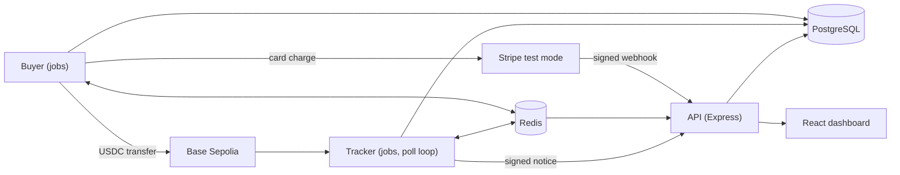

# payment-pipeline-demo

[](https://github.com/batihandev/payment-pipeline-demo/actions/workflows/ci.yml)

A payment-tracking demo follows test purchases through two payment rails into one ledger. On the chain rail, test USDC moves on Base Sepolia from broadcast through confirmation, settlement and shop notification. On the card rail, a saved Stripe test card is charged and the payment settles from a signed Stripe webhook. Separate buyer, tracker and API services share a PostgreSQL ledger and Redis, with a React dashboard showing payment progress.

Both rails run on test networks only. Stripe runs in test mode: configuration rejects any `sk_live_` key, and any other key that does not start with `sk_test_`. Visitors never enter card details; the demo pays with a test card saved in Stripe for the demo's own customer. No card data is stored beyond Stripe IDs, the card brand and its last four digits.



Every order has a rail. A chain order's expected amount is its price plus a unique offset of 1 to 9,999 micro-units, and the tracker matches transfers to orders by that amount. A card order's expected amount is its price in micro-units with no offset (price in cents times 10,000); the tracker never matches a transfer to a card order, so a chain transfer of the same amount cannot settle it. Item prices run from $0.50 to $2.00, because Stripe's smallest USD charge is $0.50.

On the chain rail, only transfers from `BUYER_ADDRESS` are matched to orders. Any other USDC transfer to the shop is a donation: it is stored with its sender and settles with a ledger entry, but has no order, no shop notice and no `unmatched` incident (a reorg or duplicate still records its own incident). The API shows a donation under a stable two-word name derived from the sender and never returns the address. Donations below `DONATION_MIN` are stored but not listed, streamed or counted.

Chain payments follow `sent → received → confirming → settled → notified` and gain a final flag when the chain finalizes their block. The ledger's unique payment key enforces one credit per payment.

Card payments follow `sent → processing → settled → notified`, with no confirmation count, or end at the terminal `failed` stage. The buyer creates a Stripe PaymentIntent for the order and records the payment as `processing`. The API's `POST /stripe/webhooks` route is the only writer of card settlement: `payment_intent.succeeded` writes the ledger entry, the shop notice and the order's `paid` status, and sets the final flag at once. The notice then marks the payment `notified`, as on the chain rail. A card payment's stage never moves backwards, whatever order the events arrive in.

Webhook handling:

- The route verifies Stripe's signature over the exact request body and answers `400` `invalid_signature` for a missing or bad signature. Without `STRIPE_WEBHOOK_SECRET` it rejects every webhook the same way.
- Each event id is stored once. An event delivered again changes nothing and is recorded as a `duplicate` incident.
- A `payment_intent.succeeded` event that arrives before the buyer has written its payment creates the payment from the event, which names the order in its metadata. The buyer's later write neither duplicates it nor moves its stage back.
- The outcome follows the PaymentIntent's status. `processing` moves a payment that is still `sent` to `processing`. `succeeded` settles it. `requires_payment_method` or `canceled`, which is what `payment_intent.payment_failed` carries, moves it to the terminal `failed` stage, closes the order and records one `card_failed` incident. Nothing moves a payment out of `failed` or back from `settled`.
- An intent changes a payment only when it names a card order by the `orderId` in its metadata, its amount is the order's price in cents, its currency is `usd`, and the order has no other PaymentIntent. Any other intent is stored, changes nothing and is recorded as an `unmatched` incident. Other event types are stored and ignored.
- The API reads a JSON or URL-encoded body up to 4 KB, except that a JSON `POST /stripe/webhooks` accepts up to 64 KB. A larger body answers `413` `payload_too_large`.
- Refunds and disputes are not handled.

Reconciliation catches up on webhooks that never arrive. Every minute the buyer's upkeep queue reads from Stripe the card payments still `sent` or `processing` three minutes after their last stage time, at most 20 a run. With room left, it searches Stripe for charges on card orders created in the last 24 hours that were tried but have no payment row (an order in `review`, or one that expired while failed or still pending). Each row is checked at most once every five minutes, least recently checked first, so rows Stripe keeps reporting unchanged take turns with newer ones. It applies each PaymentIntent through the same function as the webhook, so both paths give the same result. A lookup Stripe refuses for good records one `reconcile_failed` incident for that row and the run moves on; an access error (a rejected or missing API key) ends the run without per-row incidents, as does a transient error or rate limit. It does nothing while Stripe is cooling down. A scheduled order that settles after it was closed takes its daily budget reservation back.

## Purchases

Two kinds of purchase share one queue and have separate limits.

- **Scheduled purchases** make the shop look busy through the day. They share a daily budget per UTC day, by count and total amount (`DAILY_COUNT_CAP`, default 100; `DAILY_AMOUNT_CAP`, default 200 USDC). One in three is paid by card: the rail comes from the first byte of the SHA-256 of the order id, so it is repeatable, and only when the demo customer has a saved card and the buyer has `STRIPE_SECRET_KEY`. Every other scheduled purchase is paid on chain.
- **Visitor test buys** (`POST /test-purchases`, body `{"rail": "chain" | "card"}`, default `chain`) are sent at once, at the highest queue priority and outside the daily budget, so a visitor never waits behind the schedule. The response carries the order id, its queue position and its expiry; `GET /test-purchases/:id` returns `{position, closed}`: the position of a purchase that is still waiting and whether its order closed without a payment being sent. A card buy answers `503` `card_unavailable` unless the card rail is available. The checkout shows "Queued · N ahead" until it is sent, and reopens with a "did not go through" note when the purchase fails. If a card payment is still `processing` two minutes after Stripe accepted it, the checkout reopens its buttons with a calm "Still processing" note; the payment stays in the feed and settles when Stripe reports it. An order with no payment that is still open two minutes past its expiry also reopens the buttons, with a calm "past its expiry" note.

Both rails share the visitor limits and queue, the daily budget, orders, the ledger (one entry per payment), payment events, the live list, shop notices and retention. Only the chain rail uses the gas floor, funds hold, in-flight cap, nonces, confirmations, reorg handling and amount matching. Only the card rail uses the Stripe request limiter.

Visitor limits, with their defaults:

| Limit                         | Default                    | Response                         |
| ----------------------------- | -------------------------- | -------------------------------- |
| Per visitor (IP, hashed)      | 10 a minute, 100 a UTC day | `429` with `Retry-After`         |
| Waiting visitor purchases     | 30                         | `429` "busy", with `Retry-After` |
| Visitor purchases per UTC day | 2,000                      | `409` until 00:00 UTC            |
| Buyer gas below `GAS_FLOOR`   | n/a                        | `503` until topped up            |

Visitor chain purchases pause while the buyer's gas balance is below `GAS_FLOOR` and resume when it is topped up. Card purchases are not paused.

## Recycling and retention

USDC circulates only between the buyer and shop wallets. A nightly sweep at 03:00 UTC returns the shop's USDC to the buyer. A refill does the same on demand: when the buyer's USDC falls below `REFILL_BELOW` and the shop holds USDC and enough gas, the shop sends its whole USDC balance to the buyer, at most once per `REFILL_COOLDOWN_SECONDS`. The running cost is gas.

A nightly job deletes orders, payments, ledger entries, notices, payment events, order events, Stripe events and incidents older than `RETENTION_DAYS` (default 30), and resolved scan gaps of the same age. Open orders and payments that are unsettled or not final are kept until they close. A transfer closed because it can never land is deleted by its send time.

## RPC and Stripe budgets

The services run on free RPC tiers, so request volume stays inside their rate limits. A card send makes no RPC calls.

- Each service has its own request rate (`RPC_REQUESTS_PER_SECOND_TRACKER`, `RPC_REQUESTS_PER_SECOND_BUYER` and `RPC_REQUESTS_PER_SECOND_API`; defaults 2, 2 and 1). Together they stay at or below the provider's rate, and a burst of purchases cannot stall confirmations. A limiter delays a call until its slot instead of refusing it.
- The buyer makes about one RPC call per send (a send held for funds also reads the balance, a second call cached for 3 seconds): it signs locally with a nonce allocated in the database, a fixed gas limit and a fee cached for a few seconds. It checks for a receipt only when retrying.
- At most `MAX_IN_FLIGHT` (default 10) transfers wait unconfirmed at once. A send beyond that returns to its queue for a moment and does not count as a failed attempt.
- Before an order is sent, the buyer checks that its cached USDC balance, less the amounts in flight, covers the order. If not, the send is delayed 2 seconds and does not count as a failed attempt; the order can still expire and close.
- Every minute the buyer checks transfers the tracker has not seen two minutes after sending. One that reverted, or whose nonce another transaction used, can never land. A revert, read from its receipt, is closed with an incident at once and leaves the in-flight count; one with no receipt and a used nonce is closed only after two consecutive checks agree, and an order that leaves the unseen list forgets the suspicion. Any other is broadcast again. This check and the refill check run on their own `buyer-upkeep` queue, so held sends never delay them.
- The tracker reads new payments with one `eth_getLogs` call per pass and takes confirmations from the latest block number.
- The buyer sends at most `STRIPE_REQUESTS_PER_SECOND` (default 5) requests a second to Stripe, through a limiter of its own. A rate-limit response from Stripe starts a cooldown that delays card sends only, shown under `cooldowns.stripe` in `/health`. Chain sends and the API are unaffected. A card send that fails for a transient reason (rate limit, connection error, server error) is retried with backoff.

## Rescans and duplicates

Each tracker pass re-reads the last `RESCAN_BLOCKS` blocks. A log re-read inside that overlap, in the same block, is skipped silently. A log seen again anywhere else, such as a gap retry or a replay after a restart, is skipped and recorded as a duplicate.

## API routes

| Route                          | Purpose                                                                                                                              |
| ------------------------------ | ------------------------------------------------------------------------------------------------------------------------------------ |
| `GET /payments?limit=&before=` | Recent payments with order, stage, confirmations, block, explorer URL and note kinds; `before` pages older ones                      |
| `GET /stats`                   | Today only: settled count, average time to settle, duplicates skipped, failures recovered                                            |
| `GET /stats/daily`             | Per UTC day for the retained period: settled count, average time to settle, scheduled and visitor purchases                          |
| `GET /incidents?limit=`        | Recent incidents                                                                                                                     |
| `GET /health`                  | Head, cursor, lag, open gaps, queue depth, cooldown state, balances, low-balance flags, `cardAvailable` and the `monitoring` signals |
| `GET /events`                  | Server-sent events relayed from Redis pub/sub: payments, order changes, the visitor queue and a keep-alive                           |
| `POST /test-purchases`         | Visitor test buy                                                                                                                     |
| `GET /test-purchases/:id`      | Queue position of a waiting visitor purchase, and whether it closed without a payment being sent                                     |
| `POST /stripe/webhooks`        | Receives Stripe events, verifies their signature, then moves the card payment they name                                              |
| `POST /shop/notices`           | Receives the signed notice, verifies its signature and timestamp, then marks the payment notified                                    |

Each 4xx answers with a fixed body. Errors that reach the error filter get a fixed code for their status, such as `bad_request` or `rate_limited`, and routes send their own fixed codes, such as `busy` or `daily_limit`; bodies never echo messages.

The API allows each client address `API_REQUESTS_PER_MINUTE` requests a minute across all routes (signed shop notices and Stripe webhooks excepted) and answers over-limit requests with `429` and `Retry-After`. `/events` holds at most `STREAMS_PER_IP` open connections per address and `STREAMS_TOTAL` in all, and `/payments` is cached for 5 seconds.

The client address is the socket address. Set `CLIENT_IP_HEADER=cf-connecting-ip` when the API sits behind a Cloudflare Tunnel: the address then comes from `CF-Connecting-IP`, so per-visitor limits apply to visitors rather than to the tunnel. `X-Forwarded-For` is never read, so a client cannot choose its own address. `/events` sends a `: keep-alive` comment every 30 seconds, so Cloudflare does not close an idle stream.

## Monitoring

`GET /health` includes a `monitoring` object that an external monitor can alert on:

| Signal                                                                        | Alert when      |
| ----------------------------------------------------------------------------- | --------------- |
| Time since the tracker cursor last advanced                                   | over 1 hour     |
| Age of the oldest payment in `sent`, `received`, `confirming` or `processing` | over 1 hour     |
| Age of the oldest settled payment not yet notified                            | over 1 hour     |
| Time since the last scheduled purchase                                        | over 24 hours   |
| Time visitor test buys have been paused by the gas floor                      | over 24 hours   |
| `/health` itself unreachable                                                  | over 30 minutes |

Each condition must hold for its whole window, so failures that the services recover from on their own do not alert.

Each app writes JSON log lines, one object per line, through one Nest logger. A server error is logged with the error's name and code, the status and the matched route, never the error message, since a database or Stripe message can carry connection details. Connection failures log a fixed line with the same name and code.

Head and balances come from one chain reading that the API refreshes at most every 10 seconds, so `/health` never waits on the RPC provider. Before the first reading, or when the latest read failed, they are `null` and `chainError` names the error category. Queue depth and cooldowns are `null` while Redis is down. `/health` answers `503` only when the database is down.

## Web views

The dashboard at `/` has a checkout card, a small widget and a full panel. The checkout is labelled "Test purchase · no real money · paid from the demo's own test account" and asks for nothing. It offers two buttons: "Pay on the test network" and "Pay with a test card". The card button appears only when `/health` reports `cardAvailable`, which holds when the demo customer has a saved card and `STRIPE_WEBHOOK_SECRET` is set. A test-card purchase shows a card terminal with the saved card's brand and last four digits, then the stages Sent, Processing and Settled. A chain purchase shows blocks stacking to the confirmation threshold. A card receipt carries a "Test card" badge with the brand and last four digits (a long brand shortens, the digits stay) and a link to Stripe's receipt, and has no confirmation bar. A failed payment shows as Failed in the feed. The panel's pipeline has a lane for Processing beside the chain lanes. Failed card payments are in no lane; a line under the lanes counts them. The page follows the visitor's own order on the event stream: it reads `GET /test-purchases/:id` once and again each time the stream opens, and takes order changes and the queue from the stream's `order` and `queue` events, so nothing polls. Each receipt shows at most one note. The full panel charts settled payments per day and per week from `/stats/daily`. The widget can also be shown alone at `/?view=widget`.

## Run locally

Use Node 24, pnpm 10 and Docker Compose.

```sh
corepack enable
pnpm install
cp .env.example .env
chmod 600 .env
pnpm db:migrate --name init
pnpm build
```

Run `pnpm wallets:new` to generate buyer and shop keys with private file permissions. It preserves existing keys and prints public addresses. Fill the remaining blank configuration values in `.env` before starting the services. Use test-network keys and set `USDC_ADDRESS` to the contract address verified against Circle's documentation for the configured chain. The chain rail works without any Stripe setting; see [Card payments](#card-payments) to add the card rail.

Run each service in a separate terminal:

```sh
pnpm start:buyer
pnpm start:tracker
pnpm start:api
pnpm dev:web
```

Buyer and tracker run as Nest application contexts. All three stop cleanly on `SIGTERM` and `SIGINT`: the buyer waits for its active job, the tracker finishes its current pass, and workers, queues and Redis close. The API serves HTTP on `API_PORT` (3000 by default). Vite serves the web app at `http://localhost:5173`. Each backend validates its configuration at startup. `pnpm dev:buyer`, `pnpm dev:tracker` and `pnpm dev:api` rebuild on changes.

PostgreSQL binds to `127.0.0.1:55432` and Redis to `127.0.0.1:56379`. `pnpm db:migrate` waits for healthy services before running Prisma migrations. Compose volumes persist their data. `docker compose down` stops the services.

## Card payments

The card rail uses Stripe test mode only. The buyer charges only with a test secret key set, and the checkout offers the card only when the demo customer has a saved card and `STRIPE_WEBHOOK_SECRET` is set. `STRIPE_SECRET_KEY` must start with `sk_test_`; the buyer refuses to start with any other prefix, `sk_live_` included. The demo charges a card saved on the demo customer, off-session, so no visitor enters card details. Each charge carries the idempotency key `order-<order id>`, so a retried send returns the same PaymentIntent and never charges twice.

Set it up in this order. Run the services from the repository root with a filled `.env`:

1. Put a test secret key (`sk_test_…`) in `STRIPE_SECRET_KEY`, then run `pnpm stripe:setup`. It needs `DATABASE_URL` and `BUYER_PRIVATE_KEY` too, and the database must be migrated. It creates the demo customer in the database and in Stripe, attaches a test card (`STRIPE_PAYMENT_METHOD`, `pm_card_visa` by default) as the customer's payment method, and stores the Stripe IDs, the card brand and the last four digits. It records the chain address of `BUYER_PRIVATE_KEY` on the customer. It prints only the two IDs and the card label, and a second run changes nothing.
2. Sign in to the Stripe CLI with `stripe login`, or pass a test key with `--api-key`. Then forward webhooks to the API: `stripe listen --events payment_intent.processing,payment_intent.succeeded,payment_intent.payment_failed --forward-to localhost:<API_PORT>/stripe/webhooks` (3000 by default). It prints a signing secret that starts with `whsec_`. Put it in `STRIPE_WEBHOOK_SECRET`. For a deployed API, add a webhook endpoint at `/stripe/webhooks` in the Stripe Dashboard instead, subscribed to `payment_intent.processing`, `payment_intent.succeeded` and `payment_intent.payment_failed`, and use that endpoint's signing secret.
3. Restart the API so it reads the secret, and start the buyer after step 1 so it reads the key.

Until step 2 is done the API answers every webhook with `400`, so a card payment stays in `processing` until reconciliation reads it from Stripe. The card rail is offered only when the saved card exists and `STRIPE_WEBHOOK_SECRET` is set: then `/health` reports `cardAvailable: true` and the checkout shows the card button. Scheduled card purchases run only when the buyer has `STRIPE_SECRET_KEY`.

Card orders cost their price in cents, in USD. A declined card moves the payment to `failed`, closes the order with a `card_failed` incident and credits nothing. A Stripe error that retries cannot fix, such as a missing key or no saved card, closes the order with a `send_failed` incident; a transient error is retried with backoff and, once retries run out, the order goes to `review` with its reservation kept.

## Deploy

`deploy/` runs the demo on the server as its own compose project, `payment-pipeline-demo-deploy`, apart from any development services. It holds `compose.yaml`, `deploy.sh` and `.env.example`; the real settings live in `deploy/.env` on the server only.

The stack has its own PostgreSQL and Redis with named volumes, a one-shot `migrate` service, the `api`, `tracker` and `buyer` services and a `cloudflared` connector. The three apps run from one image, `ghcr.io/batihandev/payment-pipeline-demo:<commit>`, and `migrate` from `<commit>-migrate`; CI pushes both from `main`. Nothing publishes a port: public traffic reaches the API only through the Cloudflare Tunnel, at `http://api-live:3000` on the stack's network. `deploy.sh` gives the `api-live` alias only to the API container it has seen turn healthy, so a starting API takes no traffic; the tracker sends its notices to the same address. The API reads client addresses from `CF-Connecting-IP`. Each service gets only the settings it needs; only the buyer holds the private keys and the Stripe secret key. Every container runs with a read-only root file system, all capabilities dropped and `no-new-privileges`; every long-running container restarts unless stopped; every container keeps at most three 10 MB log files.

| Service       | Memory limit | Notes                                                                                                                       |
| ------------- | ------------ | --------------------------------------------------------------------------------------------------------------------------- |
| `api`         | 256 MB       | Health check on `/health`; 30 s to drain on stop                                                                            |
| `tracker`     | 256 MB       | 60 s to finish its pass on stop                                                                                             |
| `buyer`       | 256 MB       | 60 s to finish its active job on stop                                                                                       |
| `postgres`    | 256 MB       | `shared_buffers=64MB`                                                                                                       |
| `redis`       | 64 MB        | `maxmemory 48mb` with `noeviction`, so BullMQ keys are never evicted; append-only file synced each second, no RDB snapshots |
| `cloudflared` | 64 MB        | Runs `tunnel run` with `TUNNEL_TOKEN`; on only with the `tunnel` profile                                                    |

The limits add up to about 1.1 GB; the stack uses about 350 MB after start-up.

### One-time setup

1. Create a remote-managed Cloudflare Tunnel for the demo and give it a public hostname whose service is `http://api-live:3000`. Its token goes in `TUNNEL_TOKEN`.
2. Copy `deploy/` to the server, then `cp .env.example .env`, `chmod 600 .env`, and replace every placeholder. Use the deploy's own buyer and shop wallets (`pnpm wallets:new`), not the development ones, and list the pages that call the API in `WEB_ORIGIN`.
3. Create a Stripe sandbox for the deploy and put its test secret key in `STRIPE_SECRET_KEY`. In its Dashboard, add a webhook endpoint at `https://<public hostname>/stripe/webhooks` subscribed to `payment_intent.processing`, `payment_intent.succeeded` and `payment_intent.payment_failed`, and put its signing secret in `STRIPE_WEBHOOK_SECRET`.
4. Run the first deploy (below), then set up the demo customer against the deploy database:

   ```sh
   docker compose -f deploy/compose.yaml --env-file deploy/.env run --rm --no-deps -T buyer node dist/scripts/scripts/stripe-setup.js
   ```

### Deploy and roll back

```sh
deploy/deploy.sh <commit>
```

The script works from any directory and prints one line per step, never a setting's value:

1. It pulls both images while the running stack keeps serving.
2. It runs `migrate`. Migrations are expand-only: they add tables and columns and drop them only in a later release, so the running code works on the new schema. A new column is nullable or has a default, and no code writes a new enum value while an older tag could still run or be rolled back to, because an older Prisma client fails on an enum value it does not know. If the migration fails, the script stops and the running stack is unchanged.
3. It starts a second API on the new tag beside the running one and waits up to 90 seconds for its health check. The new API has no `api-live` alias yet, so it takes no traffic. If it never turns healthy, the script removes it and exits non-zero, and the previous API keeps serving. Otherwise the script gives it the alias and stops the previous API, which drains for up to 30 seconds; open event streams reconnect on their own.
4. It recreates the tracker, then the buyer, each stopped before the new one starts, so neither ever runs twice. Jobs wait in Redis meanwhile. Each must still be running, with no restart, 5 and 10 seconds later; otherwise the script exits non-zero and names the previous tag to roll back to.
5. It records the deployed and previous tags in `deploy/.deploy-state` and sets `IMAGE_TAG` in `deploy/.env`.
6. It keeps the deployed and previous tags and their `-migrate` tags, and removes the rest of this image. It also removes the PostgreSQL, Redis and `cloudflared` images this stack stopped using. An infra image is removed by ID only after this stack stopped using it, and Docker refuses if any container still uses it; an identical image that another stack on the server keeps without a container could be removed too, and would be pulled again when that stack next starts.

PostgreSQL, Redis and `cloudflared` are recreated only when their own configuration changes. Start and update the stack only with `deploy.sh`: a plain `docker compose up` could recreate the API without its alias. When deploying a newer commit that changes `deploy/`, copy its `deploy/` files to the server first; a rollback keeps the current files, so compose changes must also work with the previous tag. If `api-live` is missing, for example after a plain `docker compose up`, run `deploy/deploy.sh <current tag>`. To roll back, deploy the previous tag listed in `deploy/.deploy-state`; the older code runs on the newer schema. `DEPLOY_ENV_FILE` points the script at another settings file; with `COMPOSE_PROFILES` empty there, the stack runs without `cloudflared`.

A failed migration stays recorded, and Prisma refuses later migrations until it is resolved. It may have applied some of its statements before failing, so first check the database for anything it created or changed, and undo it. Then fix the cause and mark the migration rolled back with the running tag's migrate image:

```sh
docker compose -f deploy/compose.yaml --env-file deploy/.env run --rm -T migrate node node_modules/prisma/build/index.js migrate resolve --rolled-back <migration name>
```

## Configuration

`.env.example` lists the environment variables; `libs/config/src/index.ts` defines validation and defaults. Money settings use integer micro-units; native balance thresholds use wei. Quiet-window hours and budget days use UTC.

| App          | Required configuration                                              |
| ------------ | ------------------------------------------------------------------- |
| All backends | `DATABASE_URL`, `REDIS_URL`, `CHAIN_ID`, `RPC_URL`, `USDC_ADDRESS`  |
| Buyer        | `BUYER_PRIVATE_KEY`, `SHOP_PRIVATE_KEY`                             |
| Tracker      | `BUYER_ADDRESS`, `SHOP_ADDRESS`, `NOTICE_SECRET`, `SHOP_NOTICE_URL` |
| API          | `BUYER_ADDRESS`, `SHOP_ADDRESS`, `NOTICE_SECRET`, `WEB_ORIGIN`      |

Optional settings and their defaults:

| Setting                                      | Default                        | Meaning                                                                                                                                                         |
| -------------------------------------------- | ------------------------------ | --------------------------------------------------------------------------------------------------------------------------------------------------------------- |
| `API_PORT`                                   | 3000                           | API HTTP port                                                                                                                                                   |
| `DATABASE_POOL_MAX`                          | 10                             | PostgreSQL connections each app may open                                                                                                                        |
| `DATABASE_CONNECT_TIMEOUT_MS`                | 5000                           | How long a query waits for a pool connection before it fails                                                                                                    |
| `DATABASE_IDLE_TIMEOUT_MS`                   | 10000                          | How long an unused pool connection stays open                                                                                                                   |
| `API_HOST`                                   | `127.0.0.1`                    | Address the API binds to; set `0.0.0.0` inside a container                                                                                                      |
| `API_REQUESTS_PER_MINUTE`                    | 300                            | Requests one client address may make per minute, except signed shop notices                                                                                     |
| `BLOCK_EXPLORER_URL`                         | `https://sepolia.basescan.org` | Base URL for explorer links                                                                                                                                     |
| `CONFIRMATIONS`                              | 10                             | Blocks on top of a payment's block before it settles                                                                                                            |
| `START_BLOCK`                                | `RESCAN_BLOCKS` below the head | First block the tracker scans when it has no cursor                                                                                                             |
| `RESCAN_BLOCKS`                              | 5                              | Blocks re-read on each tracker pass                                                                                                                             |
| `MAX_RANGE`, `MIN_RANGE`                     | 500, 10                        | Largest and smallest block range per log query; a rejected range is halved down to the minimum                                                                  |
| `ACTIVE_POLL_MS`, `IDLE_POLL_MS`             | 2000, 30000                    | Tracker poll interval while payments are open, and otherwise                                                                                                    |
| `RPC_COOLDOWN_MS`                            | 30000                          | Pause for a service (RPC or Stripe) after a rate-limit response                                                                                                 |
| `RPC_MAX_ATTEMPTS`, `GAP_MAX_ATTEMPTS`       | 3, 5                           | Attempts per RPC call, and attempts per stored scan gap                                                                                                         |
| `ORDER_TTL_MINUTES`                          | 30                             | Minutes before an unpaid order expires                                                                                                                          |
| `QUIET_START_HOUR_UTC`, `QUIET_END_HOUR_UTC` | 0, 7                           | UTC hours in which scheduled purchases are less likely                                                                                                          |
| `LOW_NATIVE_BALANCE`, `LOW_USDC_BALANCE`     | 1000000000000000, 10000000     | Balances (wei, micro-units) below which `/health` flags `lowNative` / `lowUsdc`                                                                                 |
| `RPC_REQUESTS_PER_SECOND_TRACKER`            | 2                              | Tracker's RPC request rate                                                                                                                                      |
| `RPC_REQUESTS_PER_SECOND_BUYER`              | 2                              | Buyer's RPC request rate                                                                                                                                        |
| `RPC_REQUESTS_PER_SECOND_API`                | 1                              | API's RPC request rate; the three together stay within the provider's rate                                                                                      |
| `DAILY_COUNT_CAP`, `DAILY_AMOUNT_CAP`        | 100, 200000000                 | Scheduled purchases per UTC day and their total in micro-units (200 USDC)                                                                                       |
| `VISITOR_PER_MINUTE`, `VISITOR_PER_DAY`      | 10, 100                        | Visitor purchase limits per client                                                                                                                              |
| `VISITOR_QUEUE_LIMIT`                        | 30                             | Visitor purchases waiting at once                                                                                                                               |
| `VISITOR_DAILY_LIMIT`                        | 2000                           | Visitor purchases per UTC day across all clients                                                                                                                |
| `DONATION_MIN`                               | 10000                          | Smallest donation in micro-units (0.01 USDC) the API lists, streams and counts                                                                                  |
| `GAS_FLOOR`                                  | 200000000000000                | Native balance floor in wei (0.0002 ETH)                                                                                                                        |
| `REFILL_BELOW`, `REFILL_COOLDOWN_SECONDS`    | 5000000, 20                    | Buyer USDC balance in micro-units (5 USDC) that triggers a refill, and the wait between refills                                                                 |
| `MAX_IN_FLIGHT`                              | 10                             | Buyer purchases in flight at once                                                                                                                               |
| `RETENTION_DAYS`                             | 30                             | Days that records are kept                                                                                                                                      |
| `STREAMS_PER_IP`                             | 5                              | Open live-stream connections allowed per client address                                                                                                         |
| `STREAMS_TOTAL`                              | 500                            | Open live-stream connections allowed in all                                                                                                                     |
| `STRIPE_SECRET_KEY`                          | unset                          | Stripe test-mode secret key (`sk_test_…`) for the buyer and `pnpm stripe:setup`; other prefixes, `sk_live_` included, are refused; card charges fail without it |
| `STRIPE_WEBHOOK_SECRET`                      | unset                          | API only: Stripe webhook signing secret (`whsec_…`); the API rejects every webhook with 400 and offers no card rail without it                                  |
| `STRIPE_PAYMENT_METHOD`                      | `pm_card_visa`                 | Test payment method (`pm_…`) the setup script attaches to the demo customer; read by the setup script only                                                      |
| `STRIPE_REQUESTS_PER_SECOND`                 | 5                              | Buyer's Stripe request rate                                                                                                                                     |
| `CLIENT_IP_HEADER`                           | unset                          | API only: `cf-connecting-ip` reads the client address from that header behind a Cloudflare Tunnel; unset uses the socket address                                |

`NOTICE_SECRET` must contain at least 32 characters. `WEB_ORIGIN` takes one origin or a comma-separated list, each a bare `http` or `https` origin with no path or trailing slash. Missing or invalid variables are reported together by name without printing their values. Each app also runs one database query at startup, so an unreachable `DATABASE_URL` stops it at once. `TEST_DATABASE_URL` points database tests at the local PostgreSQL instance; tests needing isolation create and reset their own schema. `TEST_REDIS_URL` points Redis and queue tests at a Redis database separate from `REDIS_URL`, because they clear their queues. `pnpm test:local` starts the `docker-compose.yml` PostgreSQL and Redis, applies the migrations and runs the suite against them. `VITE_API_URL` supplies the web app's API origin and `VITE_REPO_URL` the repository link in the "How this works" text.

## Workspace and checks

`apps/api` is an Express application; `apps/buyer` and `apps/tracker` are application contexts with `@nestjs/bullmq` processors. Each app is split into feature folders holding a module, its controller or processor, its service and `dto/` classes, with specs beside the files they test. `libs/db` owns the Prisma schema and client module; `libs/config` owns environment validation, which each app runs once at its entry point; `libs/logging` owns the JSON logger. Shared chain, domain and event code belongs in `libs/chain`, `libs/core` and `libs/events`. `web/` uses React, Vite and Vitest; `scripts/` holds command-line utilities.

```sh
pnpm lint
pnpm test
pnpm build
```

Backend tests never call Stripe. Card specs inject a fake Stripe client, and webhook specs sign their bodies with `stripe.webhooks.generateTestHeaderString`, so they exercise the real signature check. They cover a settlement written once, a `succeeded` event that arrives before the buyer's own write, a repeated event counted as a duplicate, a late `processing` event that cannot move a settled payment back, bad and missing signatures, a JSON or URL-encoded payload over 4 KB that is refused globally but accepted on the webhook route up to 64 KB, a failed payment moving to `failed` and closing its order, an event whose order, amount, currency or intent count does not match, reconciliation of a missed webhook and of a charge with no payment row, a lookup Stripe refuses, rows that take turns, the card rail offered only with a webhook secret, scheduled cards only with a Stripe key, order events and the queue snapshot on the stream, a processing charge that outlasts two minutes, a retry after a timeout that never charges twice, a declined card, Stripe rate limiting that leaves chain sends running, and a card order never matched to a chain transfer. Backend tests also prove that each app's startup validation reports every missing required variable without exposing environment values. API route tests send HTTP requests with `supertest` to an application built with `@nestjs/testing`, covering the request limit, the stream cap, the payments cache, validation and signed notices. Vitest runs the backend and web test suites. The web suite covers the page's behaviour when the API or live stream fails or answers a malformed body. The checkout's interaction tests run in jsdom with Testing Library: focus moving to the drawer, rail buttons that keep focus while busy, and the terminal's polite stage announcements. The initial migration creates the payment tables, foreign keys and unique constraints; Prisma generates the client during the build.

## Buyer jobs

The buyer queues a pacing job every UTC minute, checks the saved daily target, and reserves each order’s exact amount before enqueueing its send. Scheduled sends wait a random offset below 60 seconds; `visitor-purchase` jobs carry `{ orderId }`, run immediately at priority 1, and use the same reservation path. An order id identifies one reservation across job retries. Pending orders are recovered at startup and each minute if enqueueing was interrupted.

Open unpaid orders expire each minute. A nightly job at 03:00 UTC returns the shop’s USDC to the buyer. Sweeps have their own durable row per UTC day and use the purchase send path without consuming the purchase budget.

A Redis lock serializes each sender. A database nonce row preserves allocations across restarts and fences an expired Redis lease. Signed transfers and hashes are committed before broadcast. Retries look for a receipt and otherwise rebroadcast the stored bytes. A failure before signing can release its reservation; an uncertain broadcast keeps it. Jobs use five attempts with exponential backoff and jitter. Exhausted sends enter `review`, retain their reservation, and write an incident for manual review. Pending sends do not automatically retry after that limit.

A broadcast purchase creates a `sent` payment keyed by `sent:<order id>`. Its log index is empty until chain observation; the tracker correlates the transaction hash with this payment when recording its transfer log.

Buyer tests use a scripted chain client, isolated PostgreSQL schemas and local Redis queues. They cover the hold on a short balance, the two-run drop check, both crash windows around broadcast, durable nonce allocation, budget races and restart recovery, priority and pacing, expiry, sweep retries and failure incidents. Chain adapter tests use a local scripted transport; no automated test contacts a live chain.
