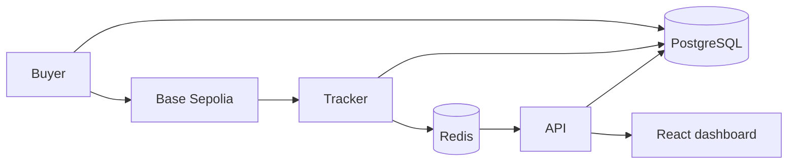

# testnet-payments

A payment-tracking demo follows test USDC purchases on Base Sepolia from broadcast through confirmation, settlement and shop notification. Separate buyer, tracker and API services share a PostgreSQL ledger and Redis, with a React dashboard showing payment progress.



Chain payments follow `sent → received → confirming → settled → notified` and gain a final flag when the chain finalizes their block. The ledger's unique payment key enforces one credit per payment.

## Run locally

Use Node 24, pnpm 10 and Docker Compose.

```sh
corepack enable
pnpm install
cp .env.example .env
chmod 600 .env
pnpm db:migrate --name init
pnpm build
```

Run `pnpm wallets:new` to generate buyer and shop keys with private file permissions. It preserves existing keys and prints public addresses. Fill the remaining blank configuration values in `.env` before starting the services. Use test-network keys and set `USDC_ADDRESS` to the contract address verified against Circle's documentation for the configured chain.

Run each service in a separate terminal:

```sh
pnpm start:buyer
pnpm start:tracker
pnpm start:api
pnpm dev:web
```

Buyer and tracker run as Nest application contexts. The API serves HTTP on port 3000 by default. Vite serves the web app at `http://localhost:5173`. Each backend validates its configuration at startup. `pnpm dev:buyer`, `pnpm dev:tracker` and `pnpm dev:api` rebuild on changes.

PostgreSQL binds to `127.0.0.1:55432` and Redis to `127.0.0.1:56379`. `pnpm db:migrate` waits for healthy services before running Prisma migrations. Compose volumes persist their data. `docker compose down` stops the services.

## Configuration

`.env.example` lists the environment variables; `libs/config/src/index.ts` defines validation and defaults. Money settings use integer micro-units; native balance thresholds use wei. Quiet-window hours and budget days use UTC.

| App          | Required configuration                                             |
| ------------ | ------------------------------------------------------------------ |
| All backends | `DATABASE_URL`, `REDIS_URL`, `CHAIN_ID`, `RPC_URL`, `USDC_ADDRESS` |
| Buyer        | `BUYER_PRIVATE_KEY`, `SHOP_PRIVATE_KEY`                            |
| Tracker      | `SHOP_ADDRESS`, `NOTICE_SECRET`, `SHOP_NOTICE_URL`                 |
| API          | `BUYER_ADDRESS`, `SHOP_ADDRESS`, `NOTICE_SECRET`, `WEB_ORIGIN`     |

`NOTICE_SECRET` must contain at least 32 characters. Missing or invalid variables are reported together by name without printing their values. `TEST_DATABASE_URL` points database tests at the local PostgreSQL instance; tests needing isolation create and reset their own schema. `VITE_API_URL` supplies the web app's API origin.

## Workspace and checks

`apps/` holds the NestJS services. `libs/db` owns the Prisma schema and client module; `libs/config` owns environment validation. Shared chain, domain and event code belongs in `libs/chain`, `libs/core` and `libs/events`. `web/` uses React, Vite and Vitest; `scripts/` holds command-line utilities.

```sh
pnpm lint
pnpm test
pnpm build
```

Jest tests prove that each app's startup validation reports every missing required variable without exposing environment values. Vitest runs the web test suite. The initial migration creates the payment tables, foreign keys and unique constraints; Prisma generates the client during the build.

## Buyer jobs

The buyer queues a pacing job every UTC minute, checks the saved daily target, and reserves each order’s exact amount before enqueueing its send. Scheduled sends wait a random offset below 60 seconds; `visitor-purchase` jobs carry `{ orderId }`, run immediately at priority 1, and use the same reservation path. An order id identifies one reservation across job retries. Pending orders are recovered at startup and each minute if enqueueing was interrupted.

Open unpaid orders expire each minute. A nightly job at 03:00 UTC returns the shop’s USDC to the buyer. Sweeps have their own durable row per UTC day and use the purchase send path without consuming the purchase budget.

A Redis lock serializes each sender. A database nonce row preserves allocations across restarts and fences an expired Redis lease. Signed transfers and hashes are committed before broadcast. Retries look for a receipt and otherwise rebroadcast the stored bytes. A failure before signing can release its reservation; an uncertain broadcast keeps it. Jobs use five attempts with exponential backoff and jitter. Exhausted sends enter `review`, retain their reservation, and write an incident for manual review. Pending sends do not automatically retry after that limit.

A broadcast purchase creates a `sent` payment keyed by `sent:<order id>`. Its log index is empty until chain observation; the tracker correlates the transaction hash with this payment when recording its transfer log.

Buyer tests use a scripted chain client, isolated PostgreSQL schemas and local Redis queues. They cover both crash windows around broadcast, durable nonce allocation, budget races and restart recovery, priority and pacing, expiry, sweep retries and failure incidents. Chain adapter tests use a local scripted transport; no automated test contacts a live chain.
